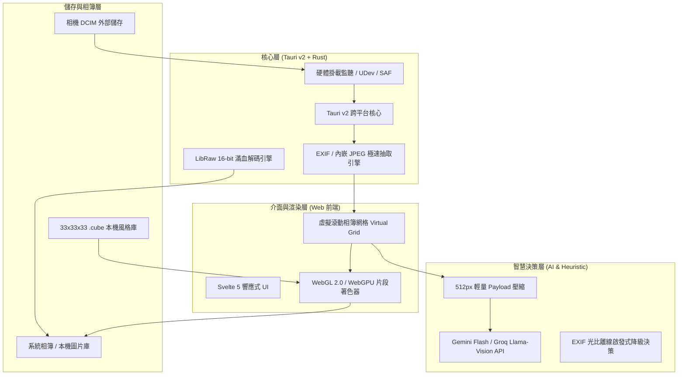

# 大相無形 / Slipknotting on Heaven's Door

> *“It's gettin' dark, too dark for me to see / I can't shoot them anymore.”*

---

## 命名緣由 / Origin & Philosophy

本專案旨在解決現代數位攝影最令人厭世的環節：相機明明拍得無比俐落，後續的匯入、暗房調色、拉桿微調卻把所有出勤的熱情消磨殆盡。中文名與英文代號分別從東方哲學與搖滾反骨的角度，定義了這套系統的核心靈魂。

### 中文名：大相無形

語出《道德經》「大象無形」，此處將「象」借為相片、照相與世間萬相之「相」。

* **無形之境，消解邊界**：最頂級的工具應當是「無形」的。使用者不該被繁雜臃腫的原廠軟體、階層過深的選單與反覆拖曳的調色介面困住。傳輸線接上、裝置通電，底層自動完成讀取、判讀與色彩映射，讓軟體徹底退至幕後。
* **回歸本相**：抽離相機品牌預設的商業調校與濾鏡標籤，回歸光子採樣與空間幾何的純粹本相。

### 英文代號：Slipknotting on Heaven's Door (`slipknot-door`)

改寫自 Bob Dylan 為西部電影創作的傳奇反戰輓歌《Knockin' on Heaven's Door》，並融入重金屬樂團 Slipknot 的硬核雙關：

1. **暗房之黑與暗部死黑（"Too dark to see"）**  
   歌詞中老警長在生命最後一刻喃喃自語，視線因為傷勢而逐漸墜入黑暗。而在傳統攝影管線裡，未經轉換的 RAW 檔與傳統暗房（Darkroom）同樣是一片死黑——動態範圍極大卻看不清細節，使用者被迫在螢幕前苦苦拉動陰影滑桿。
2. **繁瑣到讓人厭世的快門（"Can't shoot them anymore"）**  
   老警長疲憊地請求將佩槍埋入土中，象徵殺戮與爭鬥的終結；而在數位暗房裡，漫長的修圖與卡頓的流程，常常讓人疲倦到「再也不想按快門」。這套專案的存在，就是為了終結這種因工具繁瑣而扼殺攝影熱情的折磨。
3. **敲門（Knock）到套索（Slipknot）的破局**  
   原本的歌詞是在天堂門前等待救贖的無奈敲擊（Knockin'）；本專案則將其改寫為動名詞 **Slipknotting**：
   * **字面意義（Slip-knot）**：活結是一拉即解、隨抽隨開的繩結。象徵這套管線「隨插即讀、零延遲解碼」的俐落感，把過去綁死在桌面端肥大軟體裡的調色流程一秒拉開、徹底解套。
   * **搖滾暗喻**：借用重金屬的撕裂感與龐克反叛精神，不再規矩地在天堂門外輕聲叩門，而是直接把繁文縟節的暗房束縛一刀斬斷，以本機 GPU Shader 與輕量 AI 決策，暴力又優雅地直通成品的極樂之境。

> **「底層以活結破開繁瑣暗房，表層以無形之姿洞悉萬相。」**

---

## 專案核心願景

打造一套跨平台（桌面電腦 / 平板 / 手機）**本機優先（Local-first）** 的高效率 RAW 相片工作站：

* **隨插即讀**：USB/Type-C 接線或記憶卡插入即觸發底層偵測，零點擊自動掛載與掃描。
* **50ms 零延遲預覽**：抽離 RAW 內嵌全尺寸 JPEG，杜絕初期耗能的去馬賽克（Demosaicing）運算。
* **去識別化風格庫**：擺脫廠牌商業濾鏡話術，純粹以空間幾何與色彩科學出發的 3D LUT 色彩對應。
* **輕量化 AI 決策**：512px 微型 Payload 傳輸，毫秒級場景識別與參數推薦，支援完全離線降級。
* **雙模式 GPU 著色器輸出**：WebGPU/WebGL 2.0 即時預覽；提供行動端 100ms 極速直出與桌面端 16-bit 滿血解碼雙管線。

---

## 介面設計語言：Alexandria Darkroom Curatorial

本專案介面遵循 **Alexandria Darkroom Curatorial** 典藏暗房設計體系，融合古典策展典雅氛圍與現代光學暗房遙測工藝：

* **無光害暗室階層（Surfaces）**：採用低反射率義式深岩灰（Canvas Base: `#121316`）作為畫布基底，輔以 `#18191d` 面板與 `#202227` 策展卡片，徹底消除雜光對螢幕色彩判讀的干擾。
* **典藏細節與微米線條（Hairline Slate）**：全面捨棄模糊混濁的毛玻璃與大面積擴散投影，使用極細 1px 結構分界線（`#2d3039`）劃分視窗，重現光學片框與底片固定架的精密質感。
* **專業字體排印（Typography）**：
  * **Noto Serif TC / Noto Serif**：經典襯線體，用於策展主題、作品標題與相簿章節。
  * **Inter**：高辨識度無襯線體，用於敘事內容、操作指示與功能標籤。
  * **JetBrains Mono**：固定寬度等寬字體，用於 EXIF 光學遙測（光圈、快門、ISO、色溫、記憶體負載與直方圖）。
* **拱心石亮色（Accents）**：
  * **Primary Indigo (`#6082b6`)**：冷調策展藍靛，代表作用中選取外框、進度軌跡與確定按鈕。
  * **Amber Highlight (`#d4a373`)**：暖調深琥珀色，用於收藏標記、重點提示與底片齒孔編號刻度。

---

## 系統架構與技術棧

### 技術規格

| 層級 | 採用技術 | 核心職責 |
| :--- | :--- | :--- |
| **桌面 / 行動宿主** | **Tauri v2 + Rust** | 跨平台底層（Linux、macOS、Windows、Android、iOS）共用核心架構。 |
| **硬體存取** | **Rust notify / Linux UDev / Android SAF / iOS Document Picker** | 隨插即讀硬體監聽，自動識別外部 DCIM 相機目錄。 |
| **前端應用** | **Svelte 5 + Vanilla CSS (Design Tokens)** | 輕量高響應性狀態管理，遵循 Alexandria Darkroom 視覺體系。 |
| **即時渲染** | **WebGL 2.0 / WebGPU Fragment Shader** | 3D LUT 色彩查找表即時映射、曝光與陰影曲線硬體加速渲染。 |
| **視覺模型** | **Groq Llama-Vision / Google Gemini Flash** | 512px 輕量長邊影像 Base64 傳輸，回傳嚴格結構化 JSON。 |
| **離線機制** | **EXIF Rule-based Engine** | 逾時（>2500ms）或離線時，自動依焦段、快門與光比分配預設風格。 |

---

## 支援格式與相容性矩陣

* **Sony**：`.ARW`
* **Canon**：`.CR2`, `.CR3`
* **Nikon**：`.NEF`
* **Fujifilm**：`.RAF`
* **Leica / Ricoh / 通用標準**：`.DNG`
* **標準影像**：`.JPG`, `.JPEG`

---

## 3D LUT 色彩科學與開源致謝 / Acknowledgements

本專案之膠片色彩科學與相機風格比對，部分 3D LUT 紋理與曲線參照自開源社群之精確相機還原設定檔：

* **Fujifilm Camera Profiles (Classic Chrome 等)**：
  * 專案來源：[abpy/FujifilmCameraProfiles](https://github.com/abpy/FujifilmCameraProfiles/tree/master)
  * 授權條款：[CC BY-NC-SA 4.0](https://creativecommons.org/licenses/by-nc-sa/4.0/)
  * 用途說明：用於本專案 WebGL 2.0 3D 紋理之真實原廠色彩曲線映射與解碼對齊。
