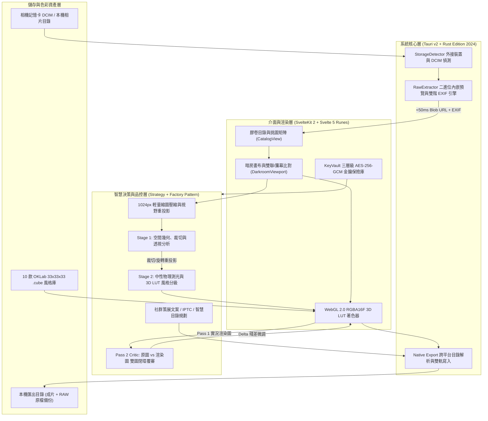

# 大相無形 / Slipknotting on Heaven's Door

> *“It's gettin' dark, too dark for me to see / I can't shoot them anymore.”*

[](LICENSE)
[](#)
[](#)
[](#)

---

## 極速挑圖 × AI 智慧暗房

**「拍完照只想馬上拿到好看的照片，不想在肥大的修圖軟體裡一張張拉滑桿到半夜。」**

**大相無形 (`slipknot-door`)** 是一套專為**節省 90% 後製時間**打造的輕量化 RAW 相片工作站。把「匯入 ➔ 挑圖 ➔ 調色 ➔ 歸檔」濃縮成最直覺的 3 個步驟：

| 步驟 | 核心體驗 | 為什麼能省下大量時間？ |
| :--- | :--- | :--- |
| **1. 秒開挑圖**<br>*(Instant Culling)* | **免轉檔等待，插卡即看** | 不跑傳統耗時的 RAW 解碼，**<50ms 直接抽離內嵌全尺寸預覽**。電腦端按 `HJKL` / `Space` 大圖 / `P` 鍵秒速挑片；平板與手機支援**長按滑刷連選**，百張照片幾分鐘內挑完。 |
| **2. AI 一鍵調色**<br>*(AI Film Grading)* | **自動配對底片風格 + 智慧構圖** | 點一下「AI 顯影調色」，AI 自動完成**水平拉平、構圖裁切、白平衡校準、曝光暗部微調**，並從 10 款 **OKLab 物理底片 LUT** 中推薦最適合的色調（支援 Hover 預覽與全卷批次調色）。 |
| **3. 智慧匯出歸檔**<br>*(Smart Export)* | **自動分資料夾 + 社群文案** | 匯出時可由 AI **自動依場景或風格建立子資料夾分類**，同步備份原始 RAW 檔，還能一鍵生成 Instagram / Threads 貼文文案與 Hashtags，修完直接發佈。 |

---

## 命名緣由 / Origin & Philosophy

本專案旨在解決現代數位攝影最令人厭世的環節：相機明明拍得無比俐落，後續的匯入、暗房調色、拉桿微調卻把所有出勤的熱情消磨殆盡。中文名與英文代號分別從東方哲學與搖滾反骨的角度，定義了這套系統的核心靈魂。

### 中文名：大相無形

語出《道德經》「大象無形」，此處將「象」借為相片、照相與世間萬相之「相」。

* **無形之境，消解邊界**：最頂級的工具應當是「無形」的。使用者不該被繁雜臃腫的軟體、階層過深的選單與反覆拖曳的調色介面困住。傳輸線接上、裝置通電，底層自動完成讀取、判讀與色彩映射，讓軟體徹底退至幕後。
* **回歸本相**：抽離相機品牌預設的商業調校與濾鏡標籤，回歸光子採樣與空間幾何的純粹本相。

### 英文代號：Slipknotting on Heaven's Door (`slipknot-door`)

改寫自 Bob Dylan 為西部電影創作的傳奇反戰輓歌《Knockin' on Heaven's Door》，並融入重金屬樂團 Slipknot 的硬核雙關：

1. **暗房之黑與暗部死黑（"Too dark to see"）**  
   歌詞中老警長在生命最後一刻喃喃自語，視線因為傷勢而逐漸墜入黑暗。而在傳統攝影管線裡，未經轉換的 RAW 檔與傳統暗房（Darkroom）同樣是一片死黑——動態範圍極大卻看不清細節，使用者被迫在螢幕前苦苦拉動陰影滑桿。
2. **繁瑣到讓人厭世的快門（"Can't shoot them anymore"）**  
   老警長疲憊地請求將佩槍埋入土中，象徵殺戮與爭鬥的終結；而在數位暗房裡，漫長的修圖與卡頓的流程，常常讓人疲倦到「再也不想按快門」。這套專案的存在，就是為了終結這種因工具繁瑣而扼殺攝影熱情的折磨。
3. **敲門（Knock）到套索（Slipknot）的破局**  
   原本的歌詞是在天堂門前等待救贖的無奈敲擊（Knockin'）；本專案則將其改寫為動名詞 **Slipknotting**：
   * **字面意義（Slip-knot）**：活結是一拉即解、隨抽隨開的繩結。象徵這套管線「隨插即讀、零延遲解碼」的俐落感，把過去綁死在桌面端肥大軟體裡的調色流程一秒拉開、徹底解套。
   * **搖滾暗喻**：借用重金屬的撕裂感與龐克反叛精神，不再規矩地在天堂門外輕聲叩門，而是直接把繁文縟節的暗房束縛一刀斬斷，以本機 GPU Shader 與輕量 AI 決策，暴力又優雅地直通成品的極樂之境。

> **「底層以活結破開繁瑣暗房，表層以無形之姿洞悉萬相。」**

---

## 專案核心願景

打造一套跨平台（桌面電腦 / 平板 / 行動端）**本機優先（Local-first）** 的高效率 RAW 相片工作站：

* **隨插即讀與多元載入**：背景自動輪詢監聽外接相機與記憶卡 `DCIM` 掛載（支援 Linux `/proc/mounts`、macOS `/Volumes`、Windows 磁碟機），並相容系統原生目錄對話框、Web File System Access API 與全視窗拖放（Drag & Drop）載入。
* **<50ms 零延遲內嵌預覽**：透過純 Rust 二進位串流掃描與雙階段 TIFF/EXIF 解析引擎，直接抽離 RAW 檔內嵌全尺寸 JPEG 與完整光學參數，轉為零記憶體洩漏的 Blob URL，杜絕初期耗能的去馬賽克（Demosaicing）運算。
* **去識別化 3D LUT 風格庫**：擺脫廠牌商業濾鏡話術，內建 `Standard` 原色直出與 10 款基於 **OKLab 感知均勻色彩空間** 數學生成的 33×33×33 `.cube` 3D LUT。
* **分階段解耦與雙圖閉環 AI 顯影**：以 1024px 輕量 Payload（30–50KB）傳輸，支援「Stage 1 空間幾何構圖 ➔ 視野重投影 ➔ Stage 2 物理測光與調色」解耦推論，以及「Pass 2 Critic 雙圖閉環覆審」品控校正。
* **純 WebGL 2.0 半精度浮點著色器**：採用 `RGBA16F` 3D 紋理三線性插值、相机順序前置白平衡（Kelvin + Tint）、非線性暗部啞光抬升（Toe Lift）、雙半徑清晰度/銳利度遮罩、Filmic 高光軟滾降與亮度加權有機銀鹽微粒。

---

## 核心功能與五大工作台模組

1. **膠卷目錄與挑圖矩陣（Catalog & Culling Matrix）**
   * **全鍵盤極速挑圖**：支援 Vim 風格導航（`HJKL` / 方向鍵移動、`P` 標記挑選、`Space` 開啟大圖預覽、`Enter` 進入暗房精修、`Del` / `Backspace` 排除底片、`Shift + Del` 實體刪除磁碟檔案（移入回收筒）），並於外接實體鍵盤時動態點亮快捷鍵導引。
   * **多維檢視與觸控滑刷**：提供 6 欄（緊密）/ 4 欄（標準）/ 3 欄（大圖）網格密度切換、僅看已挑選（Picked）過濾；桌面端支援 `Ctrl` (或 ⌘) 個別多選、`Shift` 區間連選與 `Ctrl+A` 全選批次處理；行動與觸控裝置支援長按進入多選並直接滑動連選（含邊緣自動平滑滾動）。
2. **光學暗房與精修視窗（Darkroom & Retouch Viewport）**
   * **多模式視覺比對（Curatorial Diff Engine）**：支援「單幀顯影」、「簾幕滑桿（Split Screen，可自由拖曳分割線）」與「雙聯並排（Side-by-Side Diptych）」即時對照本相與顯影成果。
   * **自由縮放與幾何構圖**：畫布支援 100%–400% 滾輪縮放、拖曳平移與雙擊復歸；內建 8 向控制點互動裁切框、6 種比例預設（原圖、`1:1`、`4:5`、`16:9`、`9:16`、自由）、水平旋轉（±45°）、3D 垂直透視梯形校正（Keystone V）與鏡像翻轉。
   * **光學遙測與精密非破壞性調校**：即時繪製 RGB 亮度波形直方圖；提供曝光（EV）、對比、暗部啞光抬升（Shadow Lift）、LUT 濃度、色溫（2800K–8500K）、色調（Tint）、清晰度與銳利度滑桿。
     * **復原與重做（Undo / Redo）**：支援鍵盤快捷鍵 `Ctrl + Z`（Mac: `⌘Z`）單步復原與 `Ctrl + Y` / `Ctrl + Shift + Z`（Mac: `⌘Y` / `⌘⇧Z`）重做，並於調色面板頂部提供即時狀態按鈕。
     * **極速歸零與微調手勢**：點兩下（雙擊）任何滑桿的標籤、數值或軌道即可瞬間歸零還原標準基準值；滑鼠懸停於滑桿上滑動滾輪支援微調，按住 `Shift` 5 倍快速微調、按住 `Alt` 0.2 倍極細微調校；點擊數值支援就地文字輸入（Inline Edit）。
     * **跨片複製與基準還原**：支援調色參數剪貼簿一鍵複製/貼上至其他底片、還原拍攝原值（As Shot）與一鍵恢復 AI 基準。
3. **AI 智慧顯影調色（Neural Bespoke Style Grading）**
   * **先選風格、Hover 即時預覽**：可指定 `AI 自動配對` 或鎖定任一典藏 3D LUT 風格，滑鼠懸停即可在主畫布即時預覽套用效果。
   * **7 款調色意境關鍵字（Vibe Keywords）**：內建 `Film Like`、`LOMO 風`、`日系空氣感`、`電影感`、`復古褪色`、`霓虹王家衛`、`粗粒子硬調`（森山大道風格）等光學指令標籤，支援在 UI 直接檢視、即時編輯或自訂底層英文 Prompt。
   * **5 項 AI 職責範圍勾選（AI Scope）**：可自由開關 AI 對「3D LUT 風格推薦」、「智慧構圖與裁切」、「梯形與水平校正」、「基礎光影與動態」、「自動色溫與色偏」的控制權，亦可在精修面板單獨觸發局部 AI 快速調校（AI 光比、AI 白平衡、AI 裁切、AI 拉平）。
   * **批次 AI 顯影與即時終端機 HUD**：支援針對已挑選或全相卷底片進行佇列式批次顯影，內建速率保護冷卻、指數退避自動重試與隨時手動中止機制。
4. **3D LUT 去識別化風格典藏庫（Curated Profiles Deck）**
   * 卡片式展示 11 款預設光學風格（含預設 EV、對比、LUT 比例與建議場景），支援一鍵套用至當前底片、套用至全相卷，以及匯入自訂標準 Adobe / DaVinci Resolve `.cube` 檔案。
5. **批次雙軌匯出與智慧歸檔（Dual-Track Export & Directory Architect）**
   * **雙模式輸出規格**：提供 **Mode A（社群速報 · Display P3 高效 JPEG）** 與 **Mode B（出版典藏母帶 · ProPhoto RGB 廣色域）**，並支援同步備份相機原始 RAW 檔至 `Raw_Backup/`。
   * **AI 智慧目錄規劃**：由 Groq / Gemini 依據拍攝日期、場景特徵、套用之 3D LUT 或使用者自訂指令，自動建立結構化歸檔子資料夾藍圖（無金鑰時自動降級為離線啟發式分類）。
   * **社群策展文案生成**：結合視覺特徵標籤與拍攝現場心情備註，一鍵生成貼文文案、Hashtags 與 IPTC 關鍵字，支援系統原生分享面板或剪貼簿快速複製。

---

## 介面設計語言：Alexandria Darkroom Curatorial

本專案介面遵循 **Alexandria Darkroom Curatorial** 典藏暗房設計體系，融合古典策展典雅氛圍與現代光學暗房遙測工藝：

* **無光害暗室階層（Surfaces）**：採用低反射率義式深岩灰（Canvas Base: `#121316`）作為畫布基底，輔以 `#18191d` 面板與 `#202227` 策展卡片，徹底消除雜光對螢幕色彩判讀的干擾。
* **典藏細節與微米線條（Hairline Slate）**：全面捨棄模糊混濁的毛玻璃與大面積擴散投影，使用極細 1px 結構分界線（`#2d3039`）劃分視窗，重現光學片框與底片固定架的精密質感。
* **專業字體排印（Typography）**：
  * **Noto Serif TC / Noto Serif**：經典襯線體，用於策展主題、作品標題與相簿章節。
  * **Inter**：高辨識度無襯線體，用於敘事內容、操作指示與功能標籤。
  * **JetBrains Mono**：固定寬度等寬字體，用於 EXIF 光學遙測（光圈、快門、ISO、色溫、記憶體負載與直方圖）。
* **拱心石亮色（Accents）**：
  * **Primary Indigo (`#6082b6`)**：冷調策展藍靛，代表作用中選取外框、進度軌跡與確定按鈕。
  * **Amber Highlight (`#d4a373`)**：暖調深琥珀色，用於收藏標記、重點提示與底片齒孔編號刻度。

---

## 系統架構與技術棧



### 技術規格

| 層級 | 採用技術 | 核心職責 |
| :--- | :--- | :--- |
| **跨平台宿主** | **Tauri v2 + Rust (Edition 2024)** | 桌面與行動端共用底層核心，提供高速二進位 I/O、對話框與系統檔案總管整合。 |
| **硬體與檔案存取** | **Rust `StorageDetector` & `RawExtractor` + Web File API** | 自動探測外接 `DCIM` 相機目錄、支援拖放與資料夾載入，<50ms 抽離 RAW 內嵌預覽與 TIFF/EXIF。 |
| **前端響應式架構** | **SvelteKit 2 + Svelte 5 (Runes) + TypeScript** | 以 `$state` / `$derived` / `$effect` 驅動零延遲暗房狀態管理，遵循 Alexandria Darkroom 設計體系。 |
| **即時光學渲染** | **WebGL 2.0 (GLSL ES 3.00) Fragment Shader** | `RGBA16F` 半精度浮點 33³ 3D LUT 三線性插值、前置白平衡、暗部啞光抬升、清晰度/銳利度遮罩、高光軟滾降與有機底片微粒。 |
| **多模態 AI 引擎** | **Google Gemini / Groq Vision & Text Adapters** | 100% 動態端點模型探測（零寫死清單），支援 Stage 1/2 幾何與色彩解耦推論、Pass 2 雙圖閉環覆審、社群文案與智慧目錄規劃。 |
| **金鑰安全與韌性** | **Web Crypto API (`PBKDF2` + `AES-256-GCM`) + Auto-Retry** | 提供明文、設備指紋透明加密、主密碼加密三層防護；具備 503/429 指數退避重試與離線啟發式目錄歸檔降級。 |

---

## 支援格式與相容性矩陣

* **Sony**：`.ARW`, `.SRF`, `.SR2`
* **Canon**：`.CR2`, `.CR3`, `.CRW`
* **Nikon**：`.NEF`, `.NRW`
* **Fujifilm**：`.RAF`
* **Panasonic / Lumix**：`.RW2`
* **Olympus / OM System**：`.ORF`
* **Pentax / Ricoh**：`.PEF`, `.PTX`
* **Leica**：`.RWL`, `.DNG`
* **Hasselblad (哈蘇)**：`.3FR`, `.FFF`
* **Phase One (飛思)**：`.IIQ`
* **Samsung**：`.SRW`
* **Sigma (適馬)**：`.X3F`
* **通用數位負片 / 開放標準 RAW**：`.DNG`
* **標準影像格式**：`.JPG`, `.JPEG`, `.PNG`, `.WEBP`

---

## 3D LUT 色彩科學與開源致謝 / Acknowledgements

本專案之直出膠片色彩科學與相機風格查找表，底層 3D LUT 核心架構採用開源色彩科學專案之精確設定檔（詳細維護規範請見 [`static/luts/README.md`](static/luts/README.md)）：

* **LUMIX Original Looks (OKLab Parametric Generation Pipeline)**：
  * 專案來源：[t0saki/lumix-original-looks](https://github.com/t0saki/lumix-original-looks)
  * 色彩科學特性：專為相機 **Standard 相片風格 + sRGB 基底** 設計的 10 款高品質 33-point `.cube` 3D LUT。不同於傳統商業 LUT 粗暴的取樣或曲線擬合，本系列全數透過 **OKLab 感知均勻色彩空間** 參數化數學模型純算生成。
  * 核心光學優勢：
    1. **長暗部漸進 (Long Toe)**：暗部細節深邃且透氣，杜絕數位死黑結塊。
    2. **高光漸進軟滾降 (Highlight Compression)**：亮部過渡柔和自然，高光去飽和防止色斑硬切。
    3. **場景純淨色彩分離**：針對街拍（`Fieldnote`）、人像膚色保護（`Heartland`）、晴天天光（`Meridian`）、電影拷貝（`Matinee`）、正片純色（`Postcard`）、大光比逆光（`Skylight`）、夜景混光抗 LED 斷階（`NightMarket`）、暮色冷暖（`DuskTide`）、林蔭綠意（`Canopy`）與斜陽金暉（`Lowsun`）量身打造。
  * 渲染整合：搭配本專案 WebGL 2.0 片段著色器之 **Filmic Soft Shoulder Roll-off** 與 **Luma-weighted 有機銀鹽微粒**，賦予 AI 一鍵直出無可挑剔的底片呼吸感。

### 內建去識別化風格對照表 (`Profile_00` ~ `Profile_10`)

| 代號 (Badge) | 系統 Profile ID | UI 名稱 | 對應 `.cube` | 核心光學特性與適用場景 |
| :--- | :--- | :--- | :--- | :--- |
| **`NATURAL_00`** | `Profile_00_StandardNatural` | **Standard · 原色自然直出** | *(Bypass LUT)* | 零風格偏調、純淨光學原色，保留相機原生寬容度。 |
| **`FIELD_01`** | `Profile_01_Fieldnote` | **Fieldnote · 日常微負片** | `Fieldnote.cube` | C-41 日常人文負片，長階調長 Toe，板岩青暗部配稻草金高光。 |
| **`HEART_02`** | `Profile_02_Heartland` | **Heartland · 溫潤人像負片** | `Heartland.cube` | 人像與室內暖光專用，保護健康膚色，溫潤通透不泛紅。 |
| **`MERIDIAN_03`** | `Profile_03_Meridian` | **Meridian · 澄澈天光紀實** | `Meridian.cube` | 中性灰軸零漂移，忠實呈現晴空戶外與建築幾何本相。 |
| **`MATINEE_04`** | `Profile_04_Matinee` | **Matinee · 放映電影拷貝** | `Matinee.cube` | 電影放映拷貝密度，黑位深沉具階調，內斂故事感光影。 |
| **`POSTCARD_05`** | `Profile_05_Postcard` | **Postcard · 明信片正片純色** | `Postcard.cube` | 反轉正片色彩提純與微密度強化，鮮明通透而不俗艷。 |
| **`SKYLIGHT_06`** | `Profile_06_Skylight` | **Skylight · 天光重組高動態** | `Skylight.cube` | 開放暗部搭配平滑高光壓縮，拯救大光比與逆光場景。 |
| **`NIGHT_07`** | `Profile_07_NightMarket` | **NightMarket · 夜市微光金芒** | `NightMarket.cube` | 夜間混光校準，鎢絲/鈉燈轉琥珀金，內建抗 LED 色階斷裂機制。 |
| **`DUSK_08`** | `Profile_08_DuskTide` | **DuskTide · 暮光藍調冷暖** | `DuskTide.cube` | 黃昏藍調時刻（Blue Hour），深青靛藍陰影對比暖金城市燈火。 |
| **`CANOPY_09`** | `Profile_09_Canopy` | **Canopy · 森綠層次透光** | `Canopy.cube` | 葉簇亮度分階，陰翳青綠與透光黃綠分離，重現自然林蔭生機。 |
| **`LOWSUN_10`** | `Profile_10_Lowsun` | **Lowsun · 金暉斜陽逆光** | `Lowsun.cube` | 金色時刻（Golden Hour），金琥珀高光對抗冷調藍陰影，立體感強烈。 |

---

## 快速開始 / Development & Verification

```bash
# 1. 安裝前端相依套件
npm install

# 2. 啟動 Web 前端開發伺服器 (支援瀏覽器預覽與本地 File API 載入)
npm run dev

# 3. 啟動 Tauri v2 桌面端完整原生應用 (含 Rust 極速 RAW 抽取與硬體掛載偵測)
npm run tauri dev

# 4. 執行型別與 Svelte 5 語法檢查
npm run check

# 5. 執行暗房核心渲染與雙圖閉環自動化驗證腳本
npm run test:darkroom
```
